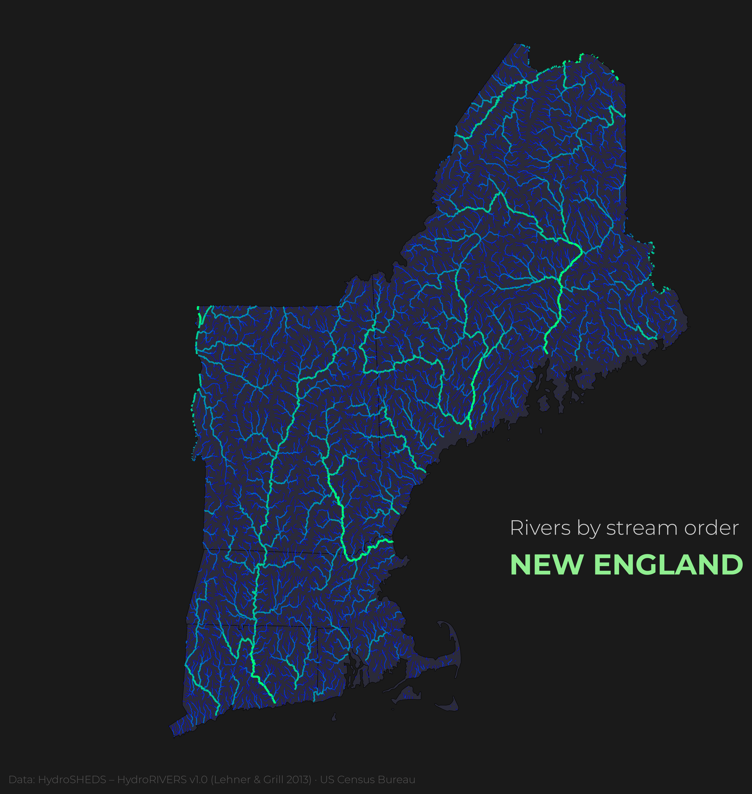

# 03 — Rivers of New England by stream order

**What it shows:** every river segment in the six New England states (15,819 segments from HydroRIVERS), with line width and color set by Strahler stream order: thin dark-blue headwater streams (order 1) up to the main stems in bright green (order 6, the Connecticut and Penobscot rivers).

**Limits:** HydroRIVERS is derived from a ~500 m resolution elevation model, so the smallest streams are simplified or missing, and channels near the coast and in flat wetlands can be approximate. Rivers are clipped to state borders, so basins that continue into Canada or New York are cut off.

**Made by a learner:** this is my first finished map in Python (GeoPandas + matplotlib), built step by step with an AI tutor giving hints and code review.

## Data (not in the repo; download it into `data/`)

| Layer | Source | File to download | Folder in `data/` |
|---|---|---|---|
| Rivers | [HydroSHEDS — HydroRIVERS v1.0](https://www.hydrosheds.org/products/hydrorivers) | North and Central America, shapefile | `HydroRIVERS_v10_na_shp/` |
| State borders | [US Census Bureau — Cartographic Boundary Files](https://www.census.gov/geographies/mapping-files/time-series/geo/cartographic-boundary.html) | States, 1:5,000,000 (2025), shapefile | `cb_2025_us_state_5m/` |

Unzip each download into `03-rivers/data/` using the folder names above, then run `notebook.ipynb` from top to bottom.

## Credits

- Rivers: Lehner, B., Grill G. (2013). Global river hydrography and network routing: baseline data and new approaches to study the world's large river systems. *Hydrological Processes*, 27(15): 2171–2186. Data available at www.hydrosheds.org.
- State borders: U.S. Census Bureau, Cartographic Boundary Files.
- Font: [Montserrat](https://github.com/JulietaUla/Montserrat) (SIL Open Font License 1.1, see `Fonts/OFL.txt`).
- Style inspired by [Milos Popovic](https://github.com/milos-agathon)'s river maps.
