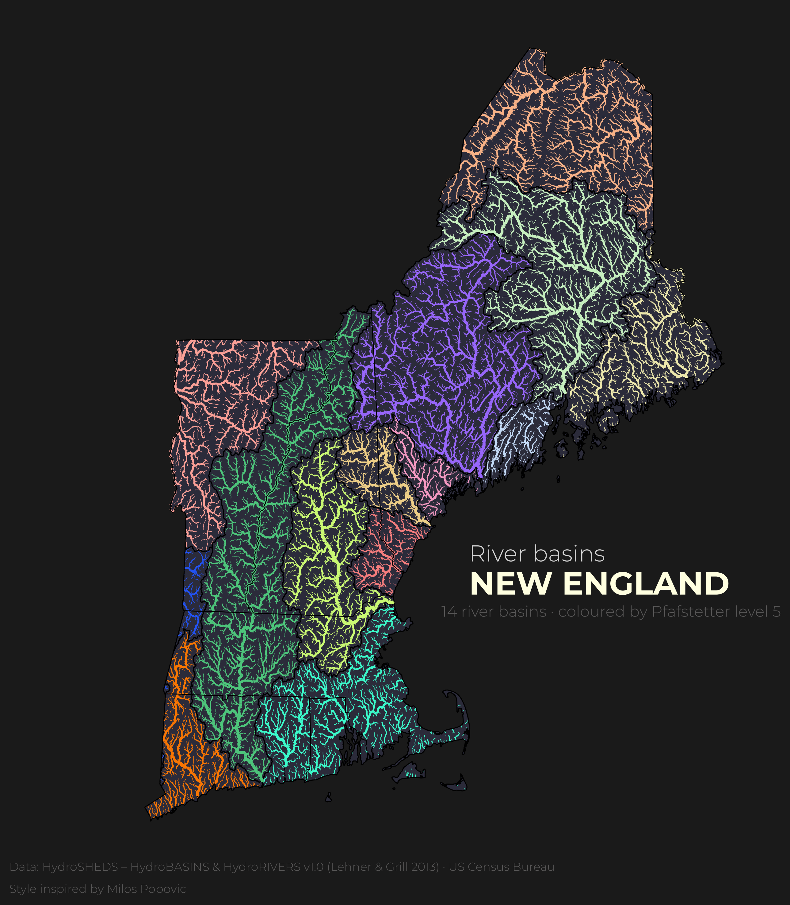

# 04 — River basins of New England

**What it shows:** the 15,819 river segments of the six New England states, colored by the river basin they drain to (14 HydroBASINS units at Pfafstetter level 5) and with line width set by Strahler stream order. Basins are not filled: each one appears only where its rivers change color, from the Connecticut River (the long green spine through Vermont, New Hampshire, Massachusetts and Connecticut) to the Kennebec and Androscoggin (purple) and the Penobscot (light green) in Maine.

**How it works:** each river segment in HydroRIVERS stores the ID of the level-12 basin it flows through (`HYBAS_L12`). Joining that ID to the HydroBASINS level-12 table gives each river its 12-digit Pfafstetter code (`PFAF_ID`). Pfafstetter codes are nested, so the first 5 digits are the river's basin at level 5.

**Limits:**
- Basins and rivers are clipped to state borders, but water doesn't stop at them. Some basins mostly lie outside New England:

| Color on the map | Basin | Share inside New England | Where it continues |
|---|---|---|---|
| Blue (western Massachusetts and Connecticut) | Hudson River | ~5% | New York, to New York Harbor |
| Salmon (western Vermont) | Lake Champlain and other St. Lawrence tributaries | ~24% | New York and Québec, to the St. Lawrence |
| Peach (northern Maine) | Saint John River | ~34% | Québec and New Brunswick, to the Bay of Fundy |
| Orange (western Connecticut) | Housatonic River and the western Long Island Sound coast | ~86% | a strip of New York; drains on its own to Long Island Sound, not to the Hudson |

- One more level-5 basin touched the state borders only as a thin sliver along the Canadian border, with no New England rivers in it (`72510`). It was left out, so the map has 14 basins.
- The data comes from a ~500 m resolution elevation model, so the smallest streams are simplified and basin borders are approximate.

**Made by a learner:** built step by step with an AI tutor giving hints and code review. Next step: an interactive version with folium.

## Data (not in the repo)

| Layer | Source | File to download | Folder |
|---|---|---|---|
| Basins | [HydroSHEDS — HydroBASINS v1c](https://www.hydrosheds.org/products/hydrobasins) | North America, standard (without lakes), levels 1–12, shapefile | `04-int_map/data/hybas_na_lev01-12_v1c/` |
| Rivers | [HydroSHEDS — HydroRIVERS v1.0](https://www.hydrosheds.org/products/hydrorivers) | North and Central America, shapefile | reused from map 03: `03-rivers/data/HydroRIVERS_v10_na_shp/` |
| State borders | [US Census Bureau — Cartographic Boundary Files](https://www.census.gov/geographies/mapping-files/time-series/geo/cartographic-boundary.html) | States, 1:5,000,000 (2025), shapefile | reused from map 03: `03-rivers/data/cb_2025_us_state_5m/` |

Download the map 03 data first (see [03-rivers](../03-rivers/)), unzip HydroBASINS into `04-int_map/data/`, then run `notebook.ipynb` from top to bottom.

## Credits

- Basins and rivers: Lehner, B., Grill G. (2013). Global river hydrography and network routing: baseline data and new approaches to study the world's large river systems. *Hydrological Processes*, 27(15): 2171–2186. Data available at www.hydrosheds.org.
- State borders: U.S. Census Bureau, Cartographic Boundary Files.
- Font: [Montserrat](https://github.com/JulietaUla/Montserrat) (SIL Open Font License 1.1, see `Fonts/OFL.txt`).
- Style inspired by [Milos Popovic](https://github.com/milos-agathon)'s river basin maps.
