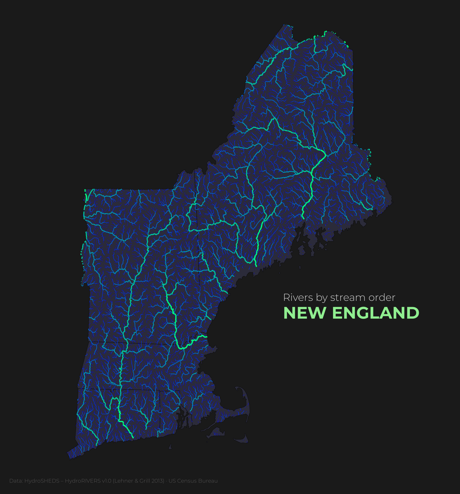
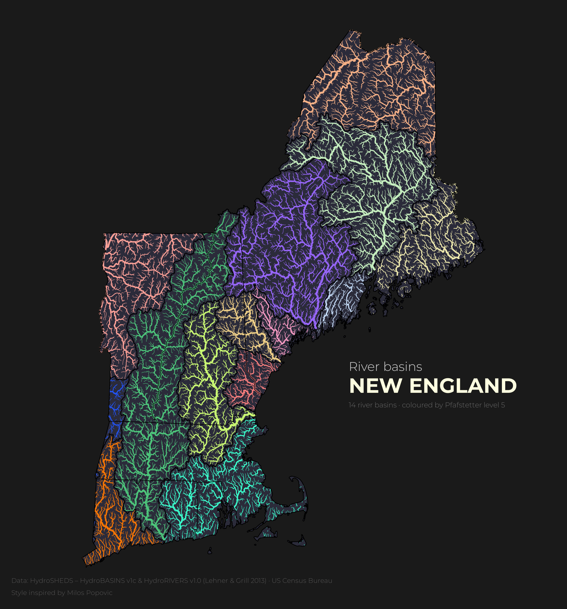

# Hydro Maps

A collection of the maps I make about water systems: rivers, basins, gauges and relief, mostly in New England. I'm a civil engineer who specialized in hydro-technics (Pontificia Universidad Javeriana), and a Python **beginner**. These maps are how I'm learning geospatial data in Python, and my entries for the [#30DayMapChallenge](https://30daymapchallenge.com/) 2026.

| | |
|---|---|
| [](03-rivers/) | [](04-int_map/) |
| **03 · Rivers of New England**, by Strahler stream order | **04 · River basins of New England**, rivers colored by basin |

## Maps

| # | Map | Question | Skills | Data | Status |
|---|-----|----------|--------|------|--------|
| 01 | [Stream gauges](01-points/) | Where are Massachusetts' rivers measured, and how many monitoring sites are still active? | GeoPandas, matplotlib, contextily | USGS Water Data | guided exercise, redoing it myself |
| 02 | [Charles River sinuosity](02-lines/) | How much does the Charles River meander between its source and Boston Harbor? | osmnx, projections, line lengths | OpenStreetMap | guided exercise, redoing it myself |
| 03 | [Rivers of New England](03-rivers/) | How is New England's river network organized, from headwater streams to main stems? | bbox loading, CRS, clipping, styling by column, custom fonts | HydroRIVERS v1.0 · US Census Bureau | **done** |
| 04 | [River basins of New England](04-int_map/) | Which basin does each New England river drain to? | joins, Pfafstetter codes, custom colormaps | HydroBASINS v1c · HydroRIVERS v1.0 · US Census Bureau | **static done**, interactive next |

## #30DayMapChallenge 2026 plan

I'm making 7 maps for the challenge, one idea each, reusing the data I already know:

| Day | Theme | Map |
|---|---|---|
| 1 | Points | stream gauges (01) |
| 2 | Lines | rivers by stream order (03) |
| 3 | Polygons | river basins (04) |
| 13 | Interactions | interactive river basins (folium) |
| 24 | Network | the river network, basin to basin downstream |
| 26 | Water | one combined New England map: basins, relief and rivers |
| 29 | Raster | shaded relief of the Charles River basin (elevation model) |

The style is inspired by [Milos Popovic](https://github.com/milos-agathon)'s river and terrain maps. He works mostly in R; I'm reproducing the ideas in Python.

## Run it yourself

```bash
python -m venv .venv
.venv\Scripts\activate        # Windows (macOS/Linux: source .venv/bin/activate)
pip install -r requirements.txt
jupyter lab
```

Each folder has a `notebook.ipynb`. Raw data is never committed: the notebook downloads it, or the folder README says where to download it and which `data/` folder to unzip it into.

## Credits

- Data: U.S. Geological Survey (USGS) Water Data; © OpenStreetMap contributors (ODbL); HydroSHEDS / HydroBASINS v1c and HydroRIVERS v1.0 (Lehner & Grill 2013); U.S. Census Bureau cartographic boundaries; basemap: Esri World Gray Canvas (Esri, HERE, Garmin, © OpenStreetMap contributors).
- Tutorials: Milán Janosov, [*30-Day Map Challenge*](https://milanjanosov.substack.com/p/30-days-30-maps-my-full-30daymapchallenge-26f).
- How these maps were made: I write the code for maps 03 and 04 myself, with an AI tutor (Claude Code) giving hints, explanations and code review. The tutor also set up this repo, wrote parts of the documentation, did some cleanup, and wrote `plate_canvas.py`, the shared export code that gives every map the same canvas size and title position. Maps 01 and 02 started as worked examples built by the tutor, and I'm redoing them on my own.
